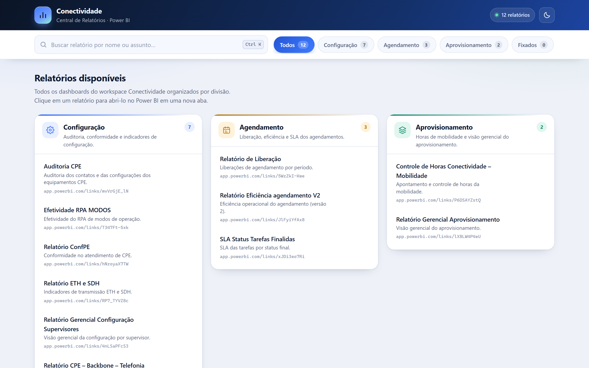
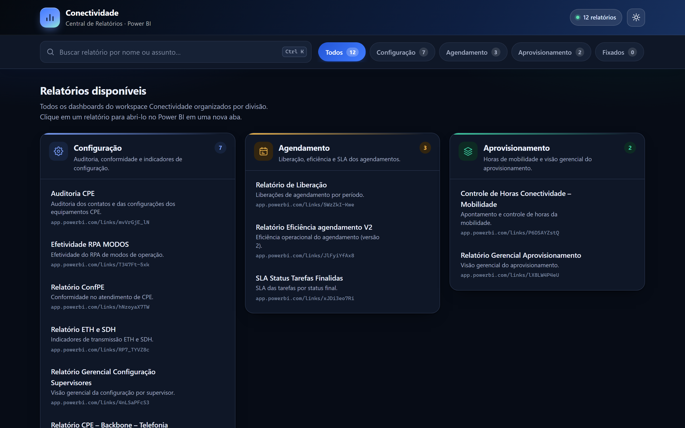
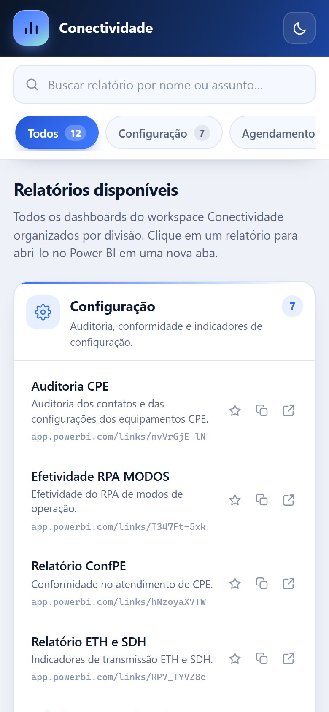

# Conectividade · Central de Relatórios

Página estática que reúne os relatórios do workspace **Conectividade** (Power BI)
divididos em três áreas: **Configuração**, **Agendamento** e **Aprovisionamento**.

## Como abrir

- **Duplo clique** em `index.html` (funciona sem servidor), ou
- publique a pasta em qualquer servidor estático (IIS, SharePoint, Nginx, GitHub Pages).

Não há build, instalação ou dependência externa.

## Prévia visual

Imagens geradas a partir da própria página, na pasta `preview/`:

**Desktop — tema claro**



**Desktop — tema escuro**



**Celular (390 px)**



## Estrutura

| Arquivo | Responsabilidade |
|---|---|
| `index.html` | estrutura da página |
| `css/styles.css` | estilos (tema claro/escuro, responsivo, impressão) |
| `js/reports.js` | catálogo de relatórios — **edite aqui** |
| `js/app.js` | busca, filtros, favoritos e ações |
| `preview/` | imagens de referência do layout (não usadas pela página) |

## Como alterar ou adicionar um relatório

Abra `js/reports.js` e edite o bloco do relatório:

```js
{
  id: "auditoria-cpe",                 // único, sem espaços
  nome: "Auditoria CPE",               // título exibido
  descricao: "Auditoria dos contatos", // uma linha de resumo
  url: "https://app.powerbi.com/links/..."
}
```

Regras importantes:

1. A `url` deve ser copiada **inteira** do Power BI, mantendo `?ctid=...&pbi_source=linkShare`.
   Sem esses parâmetros o link compartilhado não abre.
2. Não repita um `id`.
3. Para mudar a ordem exibida, reordene os blocos ou os grupos.

Depois de salvar, recarregue a página no navegador com `Ctrl + F5`.

## Recursos da página

- Busca instantânea, sem diferenciar acentos — atalho `Ctrl + K`, `Esc` limpa.
- Filtro por divisão e por relatórios **fixados** (a estrela guarda a preferência no navegador).
- Copiar link e abrir em nova aba direto de cada item.
- Tema claro/escuro com preferência salva.
- Layout responsivo (3 colunas → 2 → 1) e impressão limpa com os links visíveis.

## Observação sobre o Power BI

Os links são do tipo *link share* e abrem em nova aba. Não são embutidos em
`<iframe>` porque o Power BI bloqueia a incorporação fora do domínio autorizado
(isso exigiria *Secure Embed* configurado no tenant).
